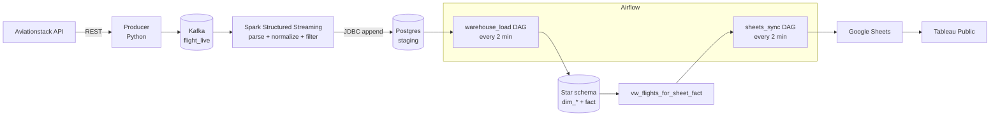

# Real-Time Flight Data Pipeline

A containerized streaming pipeline: live flight data from the **Aviationstack** API flows through **Kafka** and **Spark Structured Streaming** into a **PostgreSQL** star-schema warehouse, is orchestrated by **Apache Airflow**, mirrored to **Google Sheets**, and visualized in **Tableau Public**.

[](../../actions/workflows/ci.yml)

## What you get

- **Streaming ingest** – a Python producer polls Aviationstack and writes JSON events to the Kafka topic `flight_live`.
- **PySpark stream** – parses and normalizes timestamps (Z / `+0000` / missing seconds / fractions), keeps flights whose status is `active`, `landed`, `arrived`, `en-route` or `enroute` from the last 3 days, and appends them to a Postgres staging table.
- **Postgres warehouse** – staging table, `dim_airline`, `dim_airport`, `dim_route`, the `fact_flight_status` fact table and a curated view for BI.
- **Airflow orchestration** – two DAGs (warehouse load and Sheets sync) with 3 retries, exponential backoff, execution timeouts and no overlapping runs.
- **Google Sheets sink** – incremental, at-least-once export with a keyset watermark; numeric delay columns.
- **Tableau Public** dashboards on top of the sheet.
- **Tests + CI** – unit tests (Spark transforms, producer, sheet helpers), integration tests against a real Postgres (loader SQL, view, watermark), and DAG checks.

## Architecture



## Repository layout

```text
.
├── docker-compose.yml        # whole stack; `standalone` profile swaps Airflow for loop containers
├── .env.example              # copy to .env
├── Makefile                  # `make help`
├── apps/
│   ├── producer/             # run_producer.py            API -> Kafka
│   ├── spark_app/            # flight_stream.py (I/O) + transforms.py (pure, tested)
│   ├── loader/               # load_warehouse.py          staging -> star schema
│   └── sheets_sink/          # sheets_sink.py             view -> Google Sheets
├── airflow/
│   ├── Dockerfile
│   └── dags/                 # warehouse_load_dag.py, sheets_sync_dag.py, _common.py (retry policy)
├── db/
│   ├── 00_warehouse.sql      # staging, dimensions, fact
│   ├── 01_views.sql          # sync watermark table + curated view
│   └── 02_create_airflow_db.sh
├── tests/
└── .github/workflows/ci.yml
```

## Prerequisites

- Docker with Compose v2
- An [Aviationstack](https://aviationstack.com) API key (the free tier is plain HTTP only)
- A Google Cloud **service account** with the Sheets API enabled. Download its JSON key to `~/gsa/gsa-keys.json` (or set `GSA_KEY_PATH`) and **share your target Google Sheet with the service account's email**
- Tableau Public (desktop)

## Quick start

```bash
make env                # creates .env from .env.example - now fill in the blanks
make up                 # builds and starts everything, orchestrated by Airflow
```

- Airflow UI: <http://localhost:8080> (user/password from `AIRFLOW_ADMIN_USER` / `AIRFLOW_ADMIN_PASSWORD`)
- Follow a service: `make logs SERVICE=spark` · warehouse shell: `make psql` · list topics: `make topics`

### Configuration (`.env`)

| Key | Example | Notes |
|---|---|---|
| `AVIATIONSTACK_KEY` | – | API key (required) |
| `KAFKA_TOPIC` | `flight_live` | shared by producer and Spark |
| `PGHOST` / `PGPORT` / `PGDATABASE` | `flight_postgres` / `5432` / `flight_pipeline` | Docker DNS name of the warehouse |
| `PGUSER` / `PGPASSWORD` | `flight_user` / *your choice* | there is **no default password** in code |
| `GSHEET_ID` / `GSHEET_TAB` | `1xWJ3y…` / `flight_curated` | spreadsheet ID (middle of the URL) and tab |
| `GSHEET_BATCH_SIZE` | `300` | rows per append |
| `GSA_KEY_PATH` | `~/gsa/gsa-keys.json` | host path of the service-account key |
| `AIRFLOW_DB_PASSWORD`, `AIRFLOW_FERNET_KEY`, `AIRFLOW_SECRET_KEY`, `AIRFLOW_ADMIN_*` | – | see the generation one-liners in `.env.example` |
| `CHECKPOINT_DIR`, `HOST_KAFKA_PORT` | `/tmp/chk/flights_stream`, `9094` | Spark checkpoints, host port mapping |

### Two run modes (choose one)

| Mode | Command | Loader / Sheets sync run as |
|---|---|---|
| **Airflow (default)** | `make up` | DAGs `warehouse_load` and `sheets_sync` |
| **Standalone** | `make up-standalone` | plain loop containers `loader` and `sheets-sink` |

Never run both: they do the same work.

## Reliability: where retries and idempotency live

| Layer | Mechanism |
|---|---|
| Producer | Failed API calls (including Aviationstack's HTTP-200 error bodies) are retried with exponential backoff; Kafka sends use `acks=all`, `retries=5` |
| Spark | Checkpointing; unparseable timestamps become `NULL` instead of failing the stream |
| Airflow | Every task: 3 retries, exponential backoff (30 s → 5 min), 5-minute timeout, `max_active_runs=1`, `catchup=False` |
| Loader | One server-side cutoff per run; upserts by natural key (`ON CONFLICT`); deletes only staging rows at or before the cutoff; connection retry with backoff |
| Sheets sink | Watermark advances only after a successful append (at-least-once); a row updated by the loader is appended again |

## Data model

- **`fact_flight_status_staging`** – flat stream landing table written by Spark.
- **Dimensions** – `dim_airline(airline_id, iata UNIQUE, icao, airline_name)`, `dim_airport(airport_id, iata UNIQUE, icao UNIQUE, airport_name)`, `dim_route(route_id, dep_airport_id, arr_airport_id)` with a unique departure/arrival pair.
- **`fact_flight_status`** – latest snapshot per `flight_key` (primary key) with departure/arrival timelines, delays, `airline_id`, `route_id` and `last_updated`.
- **`vw_flights_for_sheet_fact`** – denormalized view for Sheets/Tableau: `flight_key`, `flight_date`, `status`, `airline_iata`, `airline_name`, `dep_*` / `arr_*` timestamps and delays, `dep_iata`, `dep_icao`, `dep_airport`, `arr_iata`, `arr_icao`, `arr_airport`, `last_updated`.
- **`gsheet_sync_state`** – one row holding the export watermark `(last_sync_time, last_flight_key)`.

### Why the watermark has two columns

The loader stamps a whole load cycle with one `NOW()`. A watermark on `last_updated` alone would skip the remainder of a cycle whenever it holds more rows than one batch. Ordering and comparing on `(last_updated, flight_key)` makes the position unambiguous; `tests/test_warehouse_integration.py` reproduces the failure and guards the fix.

## Spark stream logic

`apps/spark_app/transforms.py` holds the pure functions; `flight_stream.py` only wires Kafka in and JDBC out.

- **`clean_ts()`** normalizes `Z` and `+0000` offsets, trims fractions to milliseconds, pads or adds missing seconds and assumes UTC when no offset is present. `TS_FMT` accepts an optional `.SSS` fraction.
- **`parse_events()`** parses the JSON into typed, flattened columns.
- **`filter_events()`** keeps rows with an accepted status, a `flight_key`, and a scheduled/actual time in the last N days (default 3).

## Testing

```bash
pip install -r requirements-dev.txt            # needs Java 17+ for PySpark
make test                                      # unit tests (Postgres integration tests are skipped)

# include the integration tests: point at a DISPOSABLE Postgres (the schema files DROP tables)
docker run -d --name pgtest -e POSTGRES_PASSWORD=postgres -p 5433:5432 postgres:16
TEST_PG_DSN="host=localhost port=5433 dbname=postgres user=postgres password=postgres" make test

# DAG checks need Airflow (CI runs them in a separate job)
pip install "apache-airflow==2.9.3" --constraint \
  https://raw.githubusercontent.com/apache/airflow/constraints-2.9.3/constraints-3.11.txt
pytest tests/test_dags.py
```

## Tableau Public

1. **Data → Google Sheets**, choose your sheet and the `flight_curated` tab (fed by `vw_flights_for_sheet_fact`).
2. Starter calculations:

```tableau
// OnTime_Arrival_Flag
IF NOT ISNULL([arr_delay_min]) THEN
  IF [arr_delay_min] <= 5 THEN "On-time" ELSE "Late" END
END

// OnTime_Arrival_Flag_Count  (use AVG over time for the on-time rate)
IF NOT ISNULL([arr_delay_min]) THEN
  IF [arr_delay_min] <= 5 THEN 1 ELSE 0 END
ELSE 0
END
```

3. Suggested views: on-time trend by `flight_date` (line), average arrival delay by airline (bar), worst routes by delay (heatmap of `dep_iata → arr_iata`). Republish after **Data → Refresh**.

The sheet is an **append-only log of updates**: a flight appears again whenever the loader updates its row, so de-duplicate on `flight_key` by taking the latest `last_updated` in Tableau.

## Operations

```bash
make down          # stop, keep data          make reset   # stop AND delete volumes
docker compose build producer spark && docker compose up -d      # after editing those apps
```

```sql
SELECT COUNT(*) FROM fact_flight_status;
SELECT * FROM vw_flights_for_sheet_fact ORDER BY last_updated DESC LIMIT 10;
SELECT * FROM gsheet_sync_state;
```

## Troubleshooting

| Symptom | Check |
|---|---|
| Nothing in staging | Producer logs (quota or key errors are printed); topic name matches in `.env`; Spark logs |
| `dim_route` empty / `route_id` NULL | The producer must send `departure.iata` / `arrival.iata`; `SELECT dep_airport_iata FROM fact_flight_status_staging LIMIT 5` |
| Airflow UI shows `warehouse_load` failing | Task log in the UI; the task retries 3 times before failing the run |
| `database "airflow" does not exist` | You are reusing a Postgres volume created before Airflow was added: run `make airflow-db` (or `make reset` for a clean start) |
| Sheets not updating | Sheet shared with the service-account email; `GSHEET_ID` / `GSHEET_TAB`; key exists at `GSA_KEY_PATH` (Docker creates an empty *directory* if the file is missing) |
| Delays appear as text in Sheets | Clear the column format and let the `ensure_sheet` task reapply it |

## Security & quotas

- Never commit `.env` files or service-account keys; both are git-ignored. Rotate any key that was ever committed.
- The Aviationstack free tier is rate-limited and HTTP-only: keep the producer interval conservative.
- Google Sheets API quotas apply: tune `GSHEET_BATCH_SIZE` and the DAG schedule.

## Ideas to extend

- Add airport geolocation and build map views in Tableau.
- Materialize daily aggregates (delay trends, airport statistics) to speed up BI.
- Add data-quality checks between staging and the fact table (row counts, null rates) as Airflow tasks.
